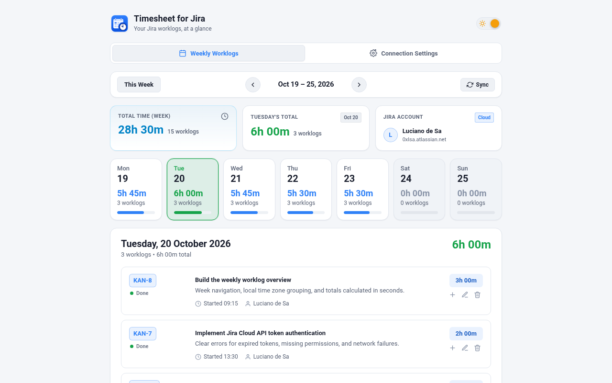
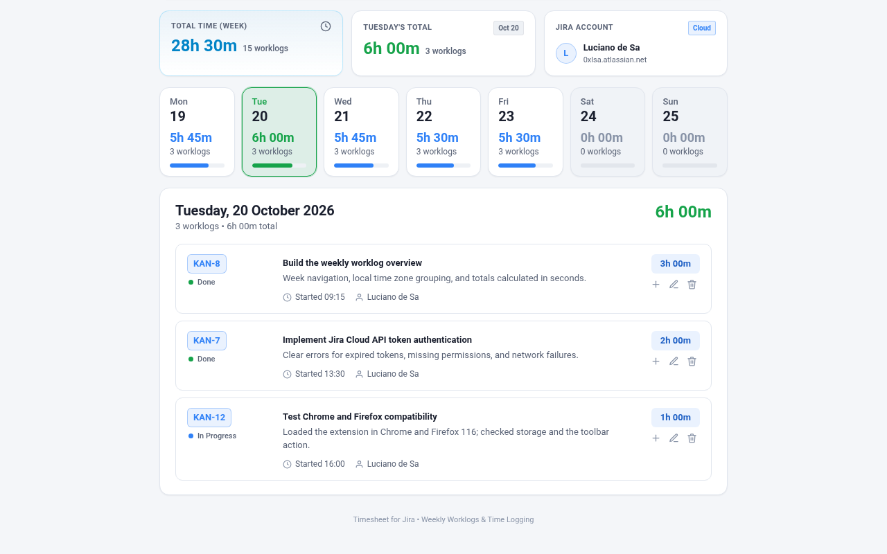
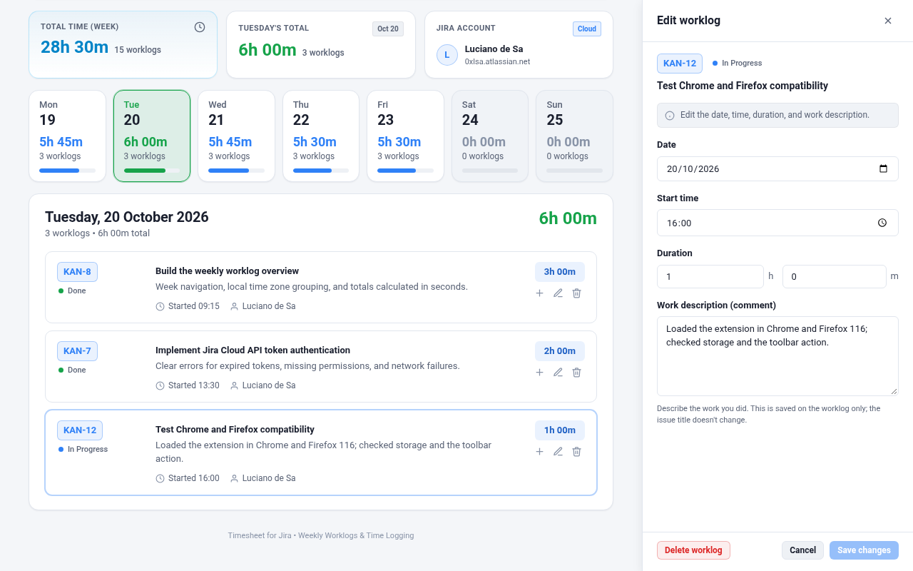
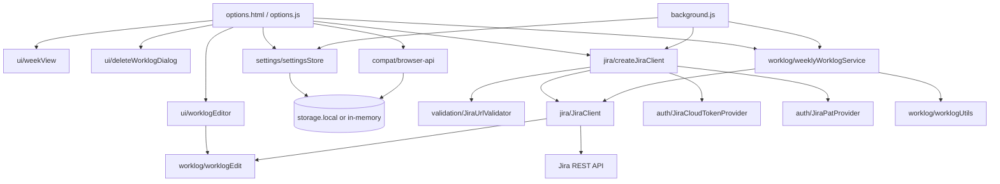

# Timesheet for Jira

**Timesheet for Jira** is a browser extension that shows your Jira worklogs as a weekly timesheet and lets you log new work and edit or delete existing worklogs from that view. It works with Jira Cloud and with Jira Data Center / Server 8.14 or later, and runs in Google Chrome (and other Chromium-based browsers) and Mozilla Firefox 140 or later (desktop) from a single Manifest V3 codebase.

## Table of contents

- [Screenshots](#screenshots)
- [Features](#features)
- [Supported browsers, Jira editions, and authentication](#supported-browsers-jira-editions-and-authentication)
- [Installation](#installation)
- [Configuration](#configuration)
- [Usage](#usage)
- [Privacy and security](#privacy-and-security)
- [Development and tests](#development-and-tests)
- [Architecture and project structure](#architecture-and-project-structure)
- [Known limitations](#known-limitations)
- [License](#license)

## Screenshots

### Weekly timesheet

See your Jira worklogs for the week, with each day's total and the week's total.



### Worklog details

Review each worklog for the selected day: the issue and its status, your work description, the start time, and the duration.



### Editing a worklog

Change an existing worklog's date, start time, duration, or work description without leaving the timesheet.



These screenshots were taken in Chrome; the extension looks and works the same in Firefox. It has light and dark themes. Dark-theme screenshots, Firefox screenshots, and the Log work and delete screens are in [`docs/screenshots/`](docs/screenshots/).

## Features

**Weekly timesheet**
- Shows your worklogs for one week, Monday through Sunday, grouped by day in your browser's local time zone.
- Previous week, next week, and **This Week** navigation, plus a **Sync** button to reload from Jira.
- Seven weekday cards with each day's total, worklog count, and a progress bar (a full bar is 8 hours). Today is marked, and weekend cards have a subtle background.
- Summary cards for the week total, the selected day's total, and the connected Jira account and edition.
- Totals are calculated in whole seconds, so the week total always equals the sum of the daily totals, and each daily total equals the sum of that day's worklogs.

**Worklog cards** (for the selected day, in start-time order)
- The issue key, linked to the issue in Jira.
- The issue's current Jira status, with a colored dot for its status category (gray for To Do, blue for In Progress, green for Done, and gray for custom or unknown categories). No status is shown when Jira doesn't return one.
- The issue summary, the worklog comment (as plain text), the start time, and the author.
- The duration, always in hours and two-digit minutes (for example, `1h 00m` or `0h 45m`).
- **+** (log work), **✎** (edit), and trash (delete) buttons, directly beneath the duration. They stay in the same place whatever the length of the title or comment.

**Editing worklogs**
- Change the date, start time, duration (hours and minutes), and work description (comment). The issue key, title, and status are read-only.
- Only the fields you changed are sent to Jira. An untouched comment keeps its Jira formatting.
- **Delete worklog** needs a separate confirmation.
- Closing, cancelling, switching worklogs or tabs, or leaving the page with unsaved changes asks first.

**Deleting worklogs**
- The trash button on a card, or **Delete worklog** in the edit panel, asks for confirmation first. The card's confirmation shows the issue, date and start time, and duration, and says the deletion can't be undone.
- The worklog disappears and the totals change only after Jira confirms the deletion. If Jira refuses (for example, without permission), the reason is shown and the worklog stays.

**Logging work**
- **+** on a worklog card opens a **Log work** form for that card's issue.
- The date defaults to the selected day and the start time to the current time. While the form is open, selecting another day in the calendar moves the date to that day, and entering a date in the displayed week selects that day.
- 15m, 30m, and 1h buttons fill in the duration; **Custom** moves to the hours field. The work description is optional.

After you save, edit, or delete a worklog, the affected days, the week total, and the counts update from Jira's response without reloading the week.

**Connection settings**
- Choose **Jira Cloud** or **Data Center / Server**. Each edition keeps its own instance URL and token, so switching editions never overwrites the other.
- **Test Connection** shows the connected account (and the Jira version on Data Center / Server). The result is cleared as soon as a connection setting changes.
- A button in the URL field opens the entered instance in a new tab (valid HTTPS URLs only).
- Instance URLs can include a context path, such as `https://jira.example.com/jira`.

**General**
- Light and dark themes, with a toggle in the header.
- No runtime dependencies and no build step.

## Supported browsers, Jira editions, and authentication

### Browsers

| Browser | Support |
| --- | --- |
| Chrome and Chromium-based browsers | Manifest V3. The manifest doesn't declare a minimum Chrome version. |
| Firefox | Desktop, 140 or later (`browser_specific_settings.gecko.strict_min_version` in `manifest.json`), the first version that supports the `data_collection_permissions` declaration (`optional_host_permissions` needs 128). |
| Firefox for Android | Not supported. The manifest has no `browser_specific_settings.gecko_android`, so the add-on is offered on desktop Firefox only. It hasn't been tested on Android; supporting it would need `gecko_android` with a minimum of 142. |

Both browsers use the same `manifest.json`. It declares `background.service_worker` (used by Chrome) and `background.scripts` (used by Firefox), so the repository folder loads unpacked in either browser. The store packages each get a copy without the other browser's keys (see [Packaging for the browser stores](#packaging-for-the-browser-stores)). See [Known limitations](#known-limitations) for what hasn't been verified in Firefox.

### Jira editions and authentication

| Jira edition | Authentication | REST API version |
| --- | --- | --- |
| Jira Cloud (`*.atlassian.net`) | Atlassian account email + API token, sent as HTTP Basic (`Authorization: Basic base64(email:token)`) | v3 (`/rest/api/3/...`) |
| Jira Data Center / Server 8.14 or later | Personal access token (PAT), sent as `Authorization: Bearer <PAT>` | v2 (`/rest/api/2/...`) |

Jira Server and Data Center versions before 8.14 don't support personal access tokens. The extension doesn't support username/password or session-cookie login, so those versions aren't compatible.

## Installation

The extension isn't published in a browser extension store. Load it from a local copy of this repository.

### Chrome and Chromium-based browsers

1. Open `chrome://extensions/`.
2. Turn on **Developer mode**.
3. Click **Load unpacked** and select the repository folder (the one containing `manifest.json`).
4. Click the extension's toolbar icon to open the timesheet in a new tab.

### Firefox (140 or later)

1. Open `about:debugging#/runtime/this-firefox`.
2. Click **Load Temporary Add-on…** and select `manifest.json` in the repository folder.
3. Click the extension's toolbar icon to open the timesheet in a new tab.

Firefox removes temporary add-ons when it restarts.

On first install, the extension opens its page automatically so you can configure the connection.

## Configuration

Open the **Connection Settings** tab.

### Jira Cloud

1. Create an API token at [id.atlassian.com/manage-profile/security/api-tokens](https://id.atlassian.com/manage-profile/security/api-tokens).
2. Under **Jira Edition**, select **Jira Cloud**.
3. Enter your **Jira Instance URL**, for example `https://your-domain.atlassian.net`.
4. Enter your **Atlassian Account Email** and the **Atlassian API Token**.
5. Click **Test Connection**. Your browser asks you to allow the extension to access your Jira site; choose **Allow**. Check that your account is shown.
6. Click **Save Settings**.

### Jira Data Center / Server

1. In Jira, open your profile, select **Personal Access Tokens**, and create a token.
2. Under **Jira Edition**, select **Data Center / Server**.
3. Enter your **Jira Instance URL**, including any context path, for example `https://jira.your-company.com/jira`.
4. Enter the **Personal Access Token (PAT)**.
5. Click **Test Connection**. Your browser asks you to allow the extension to access your Jira site; choose **Allow**. Check that your account and Jira version are shown.
6. Click **Save Settings**.

The instance URL must use HTTPS and can't contain a username or password, a query string, or a fragment. If you paste a URL that ends in a REST path such as `/rest/api/2/myself`, or in a Jira page path such as `/browse/PROJ-1` or `/secure/...`, that suffix is removed.

### Access to your Jira site

The extension has no access to any website when you install it. The first time you click **Test Connection** or **Save Settings** for a Jira site, your browser asks whether to allow Timesheet for Jira to access that one site (for example `https://jira.your-company.com/*`). The browser doesn't ask again for a site you've already allowed.

- If you decline, settings are still saved, and the **Weekly Worklogs** tab shows an **Allow Access** button instead of loading worklogs.
- If you remove the extension's access to the site later (Chrome: the extension's **Site access** settings; Firefox: the **Permissions** tab in the Add-ons Manager), the **Weekly Worklogs** tab offers **Allow Access** again.
- When you save a different instance URL, access to Jira sites that are no longer in your settings is removed. The Jira Cloud and Data Center / Server sites are both kept, so switching edition doesn't ask again.
- Access is per host, on any port: Firefox doesn't support ports in permission patterns, so `https://jira.internal:8443` is requested as `https://jira.internal/*`.

## Usage

### Viewing your week

The **Weekly Worklogs** tab loads the current week. Use the arrows to move between weeks, **This Week** to return, and **Sync** to reload from Jira. Click a weekday card to list that day's worklogs. Selecting a day doesn't change any totals.

The timesheet shows worklogs that you authored. It finds them with the JQL query `worklogAuthor = currentUser() AND worklogDate >= … AND worklogDate <= …`, then keeps only worklogs whose start falls in the week in your browser's time zone.

### Editing a worklog

1. Click **✎** on a worklog card. The **Edit worklog** panel opens, and the card is highlighted.
2. Change the date, start time, duration, or work description, then click **Save changes**. **Save changes** is enabled only when something has changed.
3. You can also delete the worklog from the panel: click **Delete worklog**, then confirm.

If the comment has formatting from Jira Cloud (bold, lists, mentions, and so on), the panel warns that editing it here saves it as plain text. If you don't change the comment, its formatting is kept.

### Deleting a worklog

1. Click the trash button on a worklog card. A confirmation opens with the issue key and summary, the date and start time, and the duration.
2. Click **Delete worklog** to delete it from Jira, or **Cancel** (or press **Escape**) to keep it.

Nothing is deleted until you confirm. While the request runs, the buttons are disabled, so it can't be sent twice. The trash button is shown on every one of your worklogs, because Jira doesn't report in advance whether you may delete a given worklog; if it refuses, the confirmation shows Jira's reason and the worklog stays.

### Logging work

1. Click **+** on a worklog card. The **Log work** panel opens for that card's issue.
2. Check the date and start time, then enter a duration (or click 15m, 30m, or 1h).
3. Optionally, describe the work, then click **Log work**.

The new worklog appears on its day, and the timesheet switches to that day if it's in the displayed week.

### Panel layout and keyboard

On wide windows the panel sits beside the timesheet. On medium windows it covers the right side of the timesheet, and below 720 px it fills the window. **Escape** closes the panel (asking first if there are unsaved changes). Save buttons are disabled while a request is in progress, so a form can't be submitted twice.

### Errors

If Jira rejects a change, the panel stays open with your input and shows the reason. There are specific messages for an expired or revoked token, missing permission, Jira's cross-site request (XSRF) protection rejecting a request, a worklog or issue that no longer exists, values Jira doesn't accept (with Jira's own message), server errors, timeouts, and network failures.

## Privacy and security

- **Where credentials are stored:** the instance URLs, Cloud account email, and tokens are saved with the WebExtensions `storage.local` API in your browser profile. This is **not encrypted secret storage** (such as an OS keychain); anyone with access to your browser profile can read it. On shared computers, use a separate browser profile or operating-system account. Use tokens with only the access you need, and revoke them in Jira or Atlassian when you no longer use the extension.
- **Where requests go:** all Jira requests are made by `JiraClient`, which checks that every request URL has the same origin as the configured instance URL before adding credentials. The extension contains no analytics or other remote services.
- **HTTPS only:** the instance URL must use HTTPS.
- **Tokens stay in headers:** credentials are sent only in the `Authorization` header, never in URLs. Requests are sent with `credentials: 'omit'`, so browser cookies for the Jira site aren't used.
- **Logging:** the auth providers keep tokens in private fields and redact them from `toJSON()` and `toString()`, and error messages don't include tokens. This reduces the chance of a token reaching a log; it isn't a guarantee for code that reads the tokens directly.
- **Permissions:** `manifest.json` requests the `storage` permission at install time and no host permissions. `https://*/*` is listed only under `optional_host_permissions`, the upper bound of what the extension may ask for, because the instance URL is entered by the user. At run time it requests only the configured Jira site, after you click **Test Connection**, **Save Settings**, or **Allow Access** (see [Access to your Jira site](#access-to-your-jira-site)). `task package:chrome` fails if the Chrome manifest lists any `host_permissions`.
- **Content Security Policy:** extension pages use `script-src 'self'; object-src 'self';`, so only the extension's own scripts can run.
- **No HTML from strings:** the UI builds its elements with DOM APIs (`src/ui/dom.js`) and never assigns `innerHTML`. Jira data such as issue summaries, statuses, worklog comments, names, and error messages is always set as text or as an attribute value, so it can't become markup.
- **Jira permissions apply:** the extension can only read, create, edit, or delete what your Jira account is allowed to. Jira enforces this, and its errors are shown in the panel.
- **XSRF header:** every request includes `X-Atlassian-Token: no-check`, which Jira Data Center / Server expects on REST calls.

## Development and tests

There's no build step and there are no runtime dependencies. Edit the files and reload the extension in the browser.

The tests use Node.js's built-in test runner, with no dependencies to install. They were last run with Node.js 22.

```bash
npm test
```

This runs `node --test tests/*.test.js`, as defined in `package.json`.

### Packaging for the browser stores

Packaging uses [Task](https://taskfile.dev/) and needs `jq`, `zip`, and `unzip`. From the repository root:

```bash
task package:chrome    # release/timesheet-for-jira-chrome.zip, for the Chrome Web Store
task package:firefox   # release/timesheet-for-jira-firefox.zip, for Firefox Add-ons
```

Each task deletes the browser's previous zip, then copies the runtime files (the manifest, `background.js`, the options page, `icons/`, and `src/`) into `dist/chrome/` or `dist/firefox/`. The zip contains only these files, not the repository: no tests, docs, store listings, `package.json`, or hidden files. The manifest copy differs per browser:

- **Chrome** leaves out the Firefox-only keys (`browser_specific_settings` and `background.scripts`).
- **Firefox** leaves out `background.service_worker`. Firefox doesn't run extension service workers, so it runs `background.js` from `background.scripts` instead.

The task then checks the build and stops with an error, without writing a zip, if any check fails:

- **Both:** the manifest is valid JSON with Manifest V3, a name, a description, a 128 px icon, and a version that matches `package.json`. It has no `host_permissions`, and `optional_host_permissions` includes `https://*/*`. Every file the manifest names, every local file the HTML pages load, and every relative import resolves inside the build.
- **Chrome:** the description is at most 132 characters, and there's a background service worker.
- **Firefox:** `browser_specific_settings.gecko.id` is set and is an email-like ID or a GUID in braces. The task prints it, because it's the ID the add-on is published under (currently `timesheet-for-jira@0xlsa`); changing it in `manifest.json` publishes a different add-on. `strict_min_version` is set (the task prints it), and it's at least 128 when the manifest uses `optional_host_permissions` and at least 140 when it declares `data_collection_permissions`. With `gecko_android`, the Android minimum must be at least 142; without it, the task reports that Android isn't supported. `background.scripts` is set and `background.service_worker` isn't, and no script calls `chrome.*` directly outside `src/compat/browser-api.js`. A missing `browser_specific_settings.gecko.data_collection_permissions` is reported as a warning, not an error; the declaration and its reasoning are in `docs/store-listing/firefox/listing.md`.

Finally, it writes the zip with `manifest.json` at its root, tests the archive, and checks that it holds exactly the files of the build. File order, timestamps, and permissions are fixed, so the same sources always produce the same zip. `task --list` shows the separate `build:*`, `verify:*`, and `clean` tasks. Packaging doesn't run the tests, so run `npm test` before a release.

To check a package yourself:

```bash
unzip -l release/timesheet-for-jira-firefox.zip                 # manifest.json is listed without a folder
unzip -p release/timesheet-for-jira-firefox.zip manifest.json | jq .
npx web-ext lint --source-dir dist/firefox                      # Mozilla's linter (optional)
```

Upload `release/timesheet-for-jira-chrome.zip` as a new item or a new version in the [Chrome Web Store Developer Dashboard](https://chrome.google.com/webstore/devconsole). Upload `release/timesheet-for-jira-firefox.zip` in the [Firefox Add-on Developer Hub](https://addons.mozilla.org/developers/addon/submit/distribution). Firefox doesn't need a source code upload, because the package holds the original, unminified source. Building a package doesn't make it ready to publish: the store listings in `docs/store-listing/` list the decisions and assets still needed before submission.

The tests run without a browser or a Jira server: Jira responses come from a fake `fetch`, and the UI tests run against a minimal DOM in `tests/support/fakeDom.js`, which has no HTML parser and serializes nodes back to escaped HTML for assertions. There are no browser-level (end-to-end) tests in the repository.

| Test file | Covers |
| --- | --- |
| `JiraUrlValidator.test.js` | HTTPS enforcement; rejecting credentials, query strings, fragments, and malformed or empty input; context paths and custom ports; stripping REST API suffixes; same-origin checks; edition-specific example URLs |
| `JiraAuthProviders.test.js` | Basic and Bearer headers, identity endpoints, input validation, and token redaction in `toJSON()` and `toString()` |
| `JiraClient.test.js` | Test Connection on Cloud (including the v3-to-v2 fallback) and Data Center (including `serverInfo`); 401, 403, 404, and 500 errors; network failures, timeouts, and non-JSON responses; tokens never appearing in results or errors |
| `JiraClientWorklog.test.js` | JQL search and pagination on Cloud (`nextPageToken`) and Data Center / Server (`startAt`); fetching all worklogs for issues with more than 20; filtering by author and local date; issue status in the search results |
| `JiraClientWorklogWrite.test.js` | Creating, updating, and deleting worklogs on both editions: request paths and bodies, ADF comments on Cloud, validation before sending, the non-browser User-Agent on writes, and error messages (including XSRF rejections and plain-text error bodies) |
| `WorklogUtils.test.js` | Monday-based weeks and month boundaries, date keys, week range labels, duration formatting, comment parsing (plain text and ADF), aggregation and deduplication, issue status pass-through |
| `WorklogEdit.test.js` | Edit and Log work form values in local time, ADF comment conversion, Jira date/time format and UTC offsets, validation (including daylight-saving gaps), and which fields count as changed |
| `WorklogEditor.test.js` | The editor session (save, validation, errors, duplicate submits, unsaved changes, delete confirmation, Log work mode), the panel markup, and the card's action buttons |
| `DeleteWorklogDialog.test.js` | The delete confirmation: the details shown (local date, start time, duration), success, failures that keep the error, ignoring a second click while deleting, and escaping |
| `WeekView.test.js` | Issue status labels and their theme colors |
| `SafeRendering.test.js` | Jira text containing markup (such as ``) shown as text in worklog cards, the weekly view, the edit and Log work panel, the delete confirmation, and connection status messages; the DOM helpers refusing event handler attributes; the weekly view's day and edit buttons |
| `WeeklyWorklogService.test.js` | Week ranges across a daylight-saving change, loading a week, and recalculating day and week totals after creating, editing, or deleting a worklog |
| `WeeklyWorklogIntegration.test.js` | Total invariants, chronological order within days, week navigation boundaries, and day selection not changing totals |
| `SettingsStore.test.js` | Per-edition URLs and tokens, settings saved by older versions, the "configured" rule, the Cloud email, and the last connection test result |
| `CompositionAndPlatform.test.js` | The Jira client factory, worklog author matching, and the platform adapter (extension APIs and the non-extension fallback) |
| `BackgroundMessages.test.js` | The background script's `TEST_CONNECTION` and `FETCH_WORKLOGS` message handlers |

## Architecture and project structure

The entry points (`options.js` and `background.js`) compose small ES modules and pass dependencies in explicitly, so the logic runs in Node tests without a browser. The options page calls Jira directly through `JiraClient`. The background script opens the page from the toolbar icon and on first install. It also handles `TEST_CONNECTION`, `GET_SETTINGS`, and `FETCH_WORKLOGS` messages, which the current page doesn't use.



- **Auth providers (`src/auth/`):** `JiraAuthProvider` defines the contract (`getAuthHeaders`, `getIdentityEndpoint`, `getDeploymentType`, `validate`). `JiraCloudTokenProvider` implements Basic authentication with an email and API token, and `JiraPatProvider` implements Bearer authentication with a PAT.
- **Jira client (`src/jira/JiraClient.js`):** all Jira REST calls, with a 15-second timeout and the origin check. `createJiraClient.js` validates the instance URL and picks the auth provider for the edition.
- **Worklog logic (`src/worklog/`):** `worklogUtils.js` has pure functions for weeks, local-time grouping, duration formatting, and aggregation. `worklogEdit.js` converts between worklogs and the edit form, validates input, and formats Jira dates and ADF comments. `weeklyWorklogService.js` loads a week and applies created, edited, or deleted worklogs to it.
- **UI (`src/ui/`):** `weekView.js` renders the weekday cards and the selected day's worklogs. `worklogEditor.js` holds the Edit worklog / Log work panel: an editing session with no DOM dependency, plus the markup and DOM wiring. `deleteWorklogDialog.js` is the delete confirmation, a native `<dialog>` with the same split.
- **Settings (`src/settings/settingsStore.js`):** owns the storage keys, per-edition URLs and tokens, and the last connection test result. It takes the storage area as a parameter (`storage.local` in the extension, in-memory in tests).
- **Platform (`src/compat/browser-api.js`):** one implementation for Chrome and Firefox, with an in-memory storage and `window.open` fallback when the page runs outside an extension. Its `hostAccess` checks, requests, and removes access to Jira sites through the `permissions` API.

### Jira REST endpoints

| Purpose | Jira Cloud | Data Center / Server |
| --- | --- | --- |
| Current user | `GET /rest/api/3/myself` (falls back to `/rest/api/2/myself` on 404) | `GET /rest/api/2/myself` |
| Jira version (Test Connection only) | — | `GET /rest/api/2/serverInfo` |
| Find the week's worklogs | `GET /rest/api/3/search/jql`, paged with `nextPageToken` | `GET /rest/api/2/search`, paged with `startAt` |
| All worklogs of an issue (when it has more than 20) | `GET /rest/api/3/issue/{issue}/worklog` | `GET /rest/api/2/issue/{issue}/worklog` |
| Log work | `POST /rest/api/3/issue/{issue}/worklog` | `POST /rest/api/2/issue/{issue}/worklog` |
| Edit a worklog | `PUT /rest/api/3/issue/{issue}/worklog/{id}` | `PUT /rest/api/2/issue/{issue}/worklog/{id}` |
| Delete a worklog | `DELETE /rest/api/3/issue/{issue}/worklog/{id}` | `DELETE /rest/api/2/issue/{issue}/worklog/{id}` |

The search requests `fields=summary,status,worklog`, so each worklog has its issue's summary and status without extra requests. Search uses GET rather than POST because Firefox adds an `Origin` header to extension POST requests, which Jira's XSRF protection or a proxy can reject.

### Project structure

```text
├── manifest.json                 # Manifest V3, shared by Chrome and Firefox
├── options.html                  # Weekly timesheet and settings page
├── options.css                   # Light and dark themes
├── options.js                    # Page controller: view state and wiring
├── background.js                 # Toolbar action, first-install page, message handlers
├── src/
│   ├── auth/
│   │   ├── JiraAuthProvider.js        # Auth provider contract
│   │   ├── JiraCloudTokenProvider.js  # Basic auth (email + API token)
│   │   └── JiraPatProvider.js         # Bearer auth (PAT)
│   ├── compat/
│   │   └── browser-api.js             # WebExtensions access and platform adapter
│   ├── jira/
│   │   ├── JiraClient.js              # Jira REST client
│   │   └── createJiraClient.js        # Builds a client from connection settings
│   ├── settings/
│   │   └── settingsStore.js           # Settings and credential persistence
│   ├── ui/
│   │   ├── dom.js                     # Builds elements without parsing HTML
│   │   ├── connectionStatus.js        # Connection status messages on the settings page
│   │   ├── weekView.js                # Weekday cards and worklog cards
│   │   ├── worklogEditor.js           # Edit worklog / Log work panel
│   │   └── deleteWorklogDialog.js     # Delete worklog confirmation
│   ├── validation/
│   │   └── JiraUrlValidator.js        # URL validation and origin checks
│   └── worklog/
│       ├── worklogUtils.js            # Weeks, time zones, durations, aggregation
│       ├── worklogEdit.js             # Edit form conversion, validation, Jira formats
│       └── weeklyWorklogService.js    # Loads a week and applies worklog changes
├── icons/                        # Extension icons (16, 32, 48, and 128 px)
├── tests/                        # Node test suite (see above)
├── package.json                  # Metadata and the test script
├── Taskfile.yml                  # Store packaging (task package:chrome, task package:firefox)
├── LICENSE                       # MIT License
└── README.md
```

## Known limitations

- **Logging work starts from an existing worklog.** **+** is on worklog cards, so you can only log work on an issue that already has one of your worklogs in the displayed week. There's no issue search.
- **Firefox and Jira's XSRF check.** Jira rejects a `POST` that has a browser User-Agent unless its `Origin` is the Jira site itself, and Firefox's extension requests don't pass that check, so logging work failed in Firefox with a 403. Creating, editing, and deleting worklogs therefore send `User-Agent: Timesheet-for-Jira`, Atlassian's documented workaround (Firefox honors it; Chrome ignores it and doesn't need it). Search uses GET for the same reason. If a proxy or a future Jira change still rejects a request, the panel shows Jira's reason, for example "XSRF check failed".
- **Remaining estimate.** When you log, edit, or delete work, Jira adjusts the issue's remaining estimate automatically (Jira's default), as it does in Jira itself.
- **Comment formatting.** Worklog cards show comments as plain text. Editing a Jira Cloud comment with formatting saves it as plain text; the panel warns you first.
- **More than 20 worklogs per issue.** Jira's search returns at most 20 worklogs per issue. When an issue has more, the extension fetches the full list from `/issue/{issue}/worklog`.
- **Time zones near midnight.** Jira evaluates `worklogDate` in the server's or user profile's time zone, which can differ from the browser's. The JQL query adds one day on each side of the week, and the extension then filters by the browser's local time zone.
- **Jira permissions.** Issues you can't browse, and worklogs you can't view, aren't returned by Jira's search.
- **Jira versions before 8.14.** Not supported (no personal access tokens).
- **SSO and SAML.** If your instance redirects REST requests to an interactive SSO login, API tokens or PATs must be allowed to reach `/rest/api/*` directly.
- **Credential storage.** Credentials are stored in `storage.local`, which isn't encrypted secret storage (see [Privacy and security](#privacy-and-security)).

## License

Timesheet for Jira is released under the [MIT License](LICENSE). Copyright (c) 2026 Luciano de Sa.
